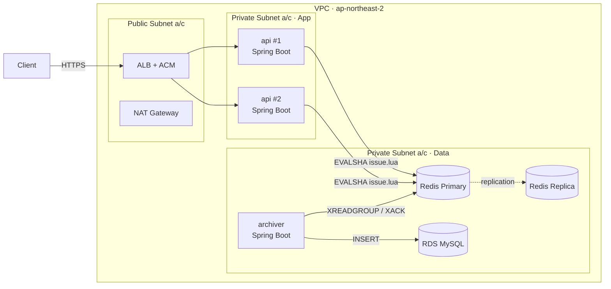

# Festival Ticketing 아키텍처 (Redis on EC2)

> 2학기 축제 티켓팅 서버의 설계 문서입니다. API는 [API.md](API.md)를 참고합니다.

---

## 1. 이전 서버리스 구조와 한계

```
Client ──HTTPS──▶ API Gateway
                     ▼
               Lambda enqueue (JWT 검증, 시간대 검증)
                     │ SendMessage (MessageGroupId = user_id % 3, DedupId = user_id)
                     ▼
               SQS FIFO
                     │ batch 10, reserved concurrency 3
                     ▼
               Lambda dequeue
                     ├─ DynamoDB counter (조건부 ADD, current_count < 900)
                     └─ DynamoDB ticket  (PutItem user_id, rank, ISSUED)
```

| 한계 | 내용 |
|---|---|
| 동시성 한도 | 부하 테스트에서 3000 요청 중 1389건 실패, `429 Too Many Requests` 다수 |
| 비동기 응답 | 사용자는 "접수됨"만 받고 결과를 바로 알 수 없음 |
| 단일 카운터 | 모든 발급이 DynamoDB 아이템 하나에 집중 (파티션당 쓰기 약 1000 WCU/s) |
| 처리 경로 직렬화 | FIFO 그룹 3개와 소비자 3개에 발급 처리량이 묶임 |
| 수동 용량 관리 | 행사 당일 Provisioned Concurrency를 직접 켜고 꺼야 함 |
| 중복 방지 기간 | SQS 중복 제거는 5분만 유효. 이후 재요청은 카운터를 다시 증가시킬 수 있음 |

---

## 2. 전체 구조

요청 경로에 큐를 두지 않고, **Redis Lua 스크립트 1회로 중복 확인, 재고 확인, 발급을 원자적으로 처리**해 결과를 즉시 응답합니다.



| 구성요소 | 역할 |
|---|---|
| ALB | HTTPS 종료, 앱 서버 분산, 헬스체크 |
| api | JWT 검증, 신청 시간 검증, Redis에 발급 판정 요청, 결과 응답 |
| Redis Primary | 재고, 발급 명단, 발급 장부의 기준 데이터. 발급 판정 수행 |
| Redis Replica | Primary 복제. 장애 시 수동 승격 |
| archiver | Redis Stream의 발급 내역을 MySQL에 저장. HTTP API 없음 |
| RDS MySQL | 축제 후에도 남는 영구 기록 |

### 2.1 요청 흐름

```
POST /api/tickets/events/{eventId}
 1. ALB → api
 2. JWT 검증 → userId, studentType
 3. 사용자별 요청 제한 확인
 4. 학생 유형별 신청 시간 판정 (결과를 Lua에 전달)
 5. Redis Lua 1회 실행
 6. 즉시 응답: ISSUED / ALREADY_ISSUED / TICKET-409 / TICKET-410
```

Lua는 "이미 발급" 분기를 가장 먼저 확인합니다. 이미 발급받은 사용자는 신청 시간 밖이나 매진 후에도 자신의 티켓을 받습니다. 같은 이유로 매진 후에도 Lua를 호출하며, 이때는 읽기만 하므로 디스크 쓰기가 발생하지 않습니다.

### 2.2 DB 기록 흐름

```
Lua (XADD ticket:{eventId}:log) ─▶ archiver: XREADGROUP → INSERT → XACK
```

- 발급과 장부 기록이 같은 Lua 안에서 실행되어 둘 중 하나만 성공하는 경우가 없습니다.
- archiver가 재시작되면 `XACK`하지 못한 메시지(PEL)부터 다시 처리합니다.
- MySQL `user_id + event_id` 유니크 제약으로 재처리해도 한 건만 저장합니다.

### 2.3 Redis 데이터 모델

| Key | 타입 | 용도 |
|---|---|---|
| `ticket:{eventId}:config` | HASH | 총 수량, 학생 유형별 시간대, 이름 |
| `ticket:{eventId}:count` | STRING | 발급 수 (= 마지막 순번) |
| `ticket:{eventId}:issued` | HASH | `userId → "rank|issuedAt"` |
| `ticket:{eventId}:log` | STREAM | 발급 장부 |
| `ratelimit:ticket:{userId}` | STRING (TTL) | 사용자별 요청 제한 |

`{eventId}`는 Redis Cluster 해시 태그로도 동작해 같은 이벤트의 키가 한 슬롯에 모입니다.

```lua
-- KEYS[1]=count, KEYS[2]=issued, KEYS[3]=log
-- ARGV[1]=userId, ARGV[2]=total, ARGV[3]=isOpen ('1' 또는 '0')
local prev = redis.call('HGET', KEYS[2], ARGV[1])
if prev then
  return {2, prev}
end

if ARGV[3] ~= '1' then
  return {3, ''}
end

local issued = tonumber(redis.call('GET', KEYS[1]) or '0')
if issued >= tonumber(ARGV[2]) then
  return {0, ''}
end

local rank = redis.call('INCR', KEYS[1])
local now = redis.call('TIME')
local issuedAt = now[1] .. '.' .. now[2]
local value = rank .. '|' .. issuedAt
redis.call('HSET', KEYS[2], ARGV[1], value)
redis.call('XADD', KEYS[3], '*', 'userId', ARGV[1], 'rank', rank, 'issuedAt', issuedAt)
return {1, value}
```

- 발급 시각은 Redis 서버 시각으로 기록해 앱 서버 시계 차이와 무관하게 순번과 시각의 순서를 맞춥니다.
- 순번은 Redis 도착 순서입니다. 클라이언트의 클릭 시각은 조작 가능하므로 기준으로 쓰지 않습니다.
- 쓰기는 발급 성공 시에만 발생하므로 `appendfsync always`를 사용합니다.

### 2.4 인프라 구성

| 구분 | 리소스 | 사양 / 비고 |
|---|---|---|
| 진입점 | ALB, ACM | HTTPS 443. 오픈 시간대에 LCU 예약 |
| 앱 서버 | Launch Template + ASG | `c7g.large` 2대. 오픈 전 예약 확장으로 4대 |
| Redis | EC2 + EBS gp3 | Primary, Replica. 시작 사양 `m7g.large`, 부하 테스트 후 조정 |
| Archiver | EC2 (Docker) | 1개 |
| DB | RDS MySQL 8 | `db.t4g.micro`, 단일 AZ, Private Subnet |
| 네트워크 | VPC, Public 2 / Private 4 | NAT Gateway 1개 |
| 이미지 | ECR | ARM64 이미지 (Graviton) |
| 접속 | SSM Session Manager | SSH와 22번 포트 미사용 |
| 시크릿 | SSM Parameter Store | `JWT_SECRET`, Redis 비밀번호, DB 비밀번호, 내부 API 키 |
| 관측 | CloudWatch | 앱 로그, ALB 5xx와 지연, 서버 메모리·CPU |

보안그룹은 다음만 허용합니다.

| 대상 | 허용 |
|---|---|
| ALB | 인터넷 → 443 |
| api | ALB → 8080 |
| Redis | api, archiver, Replica → 6379 |
| RDS | archiver → 3306 |

---

## 3. 이 구조의 장점

1. **즉시 응답**: 사용자가 요청 한 번으로 발급 결과와 순번을 받습니다.
2. **Lambda 동시성 한도 제거**: 버스트는 앱 서버의 연결 대기열과 가상 스레드로 흡수합니다.
3. **구조적인 정합성**: 판정이 Lua 안에서 원자적으로 끝나 초과 발급과 중복 발급이 발생하지 않습니다.
4. **단일 카운터 병목 해소**: 판정은 메모리에서 수십 μs 안에 끝나고, 병목은 수평 확장이 쉬운 앱 서버 쪽으로 이동합니다.
5. **요청 경로와 기록 경로 분리**: 사용자 응답은 DB 쓰기를 기다리지 않습니다.
6. **직접 운영 경험**: Redis 설정, 영속성, 복제, 장애 대응을 직접 다룹니다. EC2에 직접 올린 이유이며, 비용 절감이 목적은 아닙니다.

## 4. 단점과 대응

| 단점 | 영향 | 대응 |
|---|---|---|
| Redis 단일 장애점 | Primary 장애 시 발급 중단 | Replica 수동 승격 런북, 앱의 빠른 실패(503) |
| 비동기 복제 | 장애 전환 시 복제되지 않은 발급 유실 가능 | AOF `always`, Primary 복구 우선, archiver 저장분과 대조 |
| 메모리 기반 처리 | 처리 중인 요청은 서버 장애 시 사라짐 | 발급이 멱등이라 클라이언트 재시도로 복구 |
| 운영 부담 | 패치, 설정, 모니터링 | 코드화된 프로비저닝, SSM, 런북 |
| 느린 자동 확장 | 수 분 걸려 버스트에 대응 불가 | 오픈 전 예약 확장 |
| ALB 확장 속도 | 급격한 트래픽에 초기 5xx 가능 | LCU 예약 |
| 보안 책임 | Redis 노출 시 데이터 탈취 | Private Subnet, 보안그룹, 비밀번호/ACL |
| 상시 비용 | 사용하지 않아도 과금 | 행사 기간 외 `terraform destroy` |

---

## 5. 운영 설정

### 5.1 앱 서버

| 설정 | 값 | 이유 |
|---|---|---|
| `spring.threads.virtual.enabled` | `true` | Redis 응답 대기 중 스레드 부족 방지 |
| `server.tomcat.accept-count` | 2000 | 버스트 시 연결 거부 방지. OS `somaxconn`도 함께 상향 |
| `server.tomcat.max-connections` | 10000 | 서버당 수천 개 동시 연결 수용 |
| Lettuce `timeout` | 500ms | 기본 60초로는 Redis 장애 시 요청이 오래 매달림 |
| 서킷브레이커 | Resilience4j | Redis 장애가 앱 서버 장애로 번지지 않게 즉시 503 |
| JVM 워밍업 | 오픈 5분 전 트래픽 | JIT 최적화 전의 초기 지연 완화 |

### 5.2 Redis 서버

| 설정 | 이유 |
|---|---|
| `appendonly yes`, `appendfsync always` | 발급 기록 영속화 |
| `maxmemory-policy noeviction` | 발급 데이터가 임의로 삭제되지 않게 함 |
| `bind`, `protected-mode`, `requirepass` | 접근 제한 |
| `vm.overcommit_memory=1` | 백그라운드 저장(fork) 실패 방지 |
| Transparent Huge Pages 비활성화 | fork 이후 지연 방지 |
| `net.core.somaxconn`, `ulimit -n` 상향 | 연결 수 확보 |

### 5.3 장애 대응

- 앱은 Redis를 IP가 아닌 고정 사설 DNS 이름으로 접속해, Replica 승격 시 DNS만 변경합니다.
- 런북: Primary 장애 판단 → Replica `REPLICAOF NO ONE` → DNS 전환 → archiver 재연결 확인 → 발급 수와 MySQL 건수 대조.
- 문제가 지속되면 이전 서비스로 돌아갈 수 있도록 DNS 전환 절차를 준비합니다.

### 5.4 행사 당일 순서

1. 오픈 30분 전: ASG 예약 확장, ALB LCU 예약 확인
2. 오픈 5분 전: JVM 워밍업 트래픽
3. 오픈: 대시보드 확인 (ALB 5xx, 응답 시간, Redis CPU·연결 수, archiver 미처리 수)
4. 마감 후: 발급 수와 MySQL 건수 대조, 용량 원복

---

## 6. 결정 사항

| # | 항목 | 결정 |
|---|---|---|
| D1 | Redis 가용성 | Primary + Replica, 수동 승격 |
| D2 | 영구 저장 | Redis Streams → archiver → RDS MySQL |
| D3 | 앱 프레임워크 | Spring Boot 4, Java 21 |
| D4 | 앱 배포 | Docker + ECR |
| D5 | 아웃바운드 | NAT Gateway 1개 |
| D6 | 대기열 | 사용하지 않음. 동시 접속이 앱 서버 수용량을 넘는 규모가 되면 Sorted Set 대기실 추가 |
| D7 | 진입점 | ALB |
| D8 | 초기 사양 | App `c7g.large`, Redis `m7g.large`, RDS `db.t4g.micro`. 부하 테스트 후 조정 |
| D9 | 인증 | Spring Security 없이 Filter와 ArgumentResolver로 JWT 검증 |

---

## 7. 프로젝트 구조

```
second_festival_ticketing_server/
├── docs/
├── api/                # 발급·조회 API
├── archiver/           # Stream → MySQL 저장 워커
├── docker-compose.yml  # 로컬 Redis, MySQL
├── terraform/          # 인프라
└── loadtest/           # k6 부하 테스트
```
