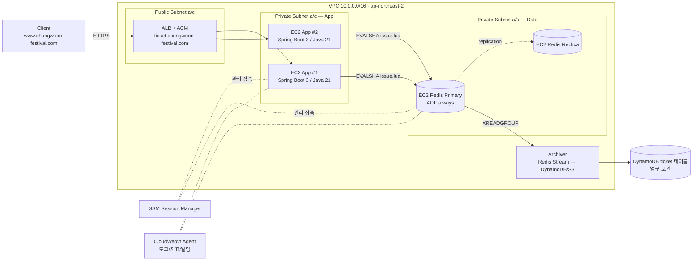

# Festival Ticketing — Redis on EC2 아키텍처 (초안 v0.1)

> 상태: **논의 중** — 아래 "결정 필요 사항"이 정해지면 Terraform/애플리케이션 코드 작성에 들어갑니다.
> 기존 서버리스 버전: `~/Desktop/항공대/4-1/축제서비스/festival_ticketing`

---

## 1. 기존 서버리스 구조 요약

```
Client ──HTTPS──▶ API Gateway (REST, ticket.chungwoon-festival.com)
                     │ AWS_PROXY
                     ▼
               Lambda enqueue (JWT 검증, 시간대 검증)  ── Provisioned Concurrency 500~900
                     │ SendMessage (MessageGroupId = user_id % 3, DedupId = user_id)
                     ▼
               SQS FIFO (High Throughput)
                     │ batch 10, reserved concurrency 3
                     ▼
               Lambda dequeue
                     ├─ DynamoDB counter (조건부 ADD, current_count < 900)
                     └─ DynamoDB ticket  (PutItem user_id, rank, ISSUED)
```

관찰된 한계 (코드 + 부하테스트 결과 기준)

| 문제 | 근거 |
|---|---|
| **Lambda 동시성 한도로 429 발생** | `loadtest/summary.json`: 3000 요청 중 1389 실패, `failures.log`에 `429 Too Many Requests` 다수 |
| **비동기라 사용자가 결과를 즉시 모름** | enqueue는 "accepted"만 반환, 결과 조회용 `lambda/query/handler.py`는 비어 있음 |
| **DynamoDB 단일 카운터 아이템 = 핫 키** | 모든 발급이 `counter_id = ticket_counter` 한 아이템에 몰림 (파티션당 쓰기 ~1000 WCU/s 한도) |
| **처리 직렬화** | FIFO 그룹 3개 + reserved concurrency 3 → 발급 처리량이 소비자 3개에 묶임 |
| **콜드스타트/비용 관리 부담** | 축제 당일 Provisioned Concurrency를 수동으로 켜고 꺼야 함 |
| **중복 요청 방어가 5분 dedup 윈도우 의존** | SQS dedup은 5분만 유효, 이후 재요청은 counter를 또 증가시킬 수 있음 (ticket 테이블 PutItem은 덮어씀 → **표 수 누수 가능**) |

---

## 2. 제안 아키텍처 (Redis on EC2)

핵심 아이디어: **큐를 없애고, Redis Lua 스크립트 한 번으로 "중복 확인 + 재고 확인 + 발급"을 원자적으로 처리**하여 요청 안에서 바로 결과(순번)를 돌려준다.



### 2.1 요청 흐름

```
POST /ticket
 1. ALB → App (HTTP keep-alive)
 2. App: JWT 검증(HS256) → userId, studentType
 3. App: 시간대 검증 (KST, Amazon Time Sync로 시간 동기화)
 4. App: 로컬 "매진 플래그"가 켜져 있으면 Redis 안 가고 즉시 409 SOLD_OUT
 5. App → Redis: EVALSHA issue.lua  (1 RTT, 원자적)
 6. 결과에 따라 즉시 응답
      200 {status: ISSUED, rank: 123}
      200 {status: ALREADY_ISSUED, rank: 45}
      409 {status: SOLD_OUT}

GET /ticket   (기존에 비어 있던 조회 API)
 → HGET ticket:issued <userId>
```

### 2.2 Redis 데이터 모델 & Lua 스크립트

| Key | 타입 | 용도 |
|---|---|---|
| `ticket:{event}:count` | STRING(int) | 발급된 수 (= 마지막 rank) |
| `ticket:{event}:issued` | HASH | `user_id → "rank|requested_at"` |
| `ticket:{event}:log` | STREAM | 발급 이벤트 로그 → 아카이버가 DynamoDB로 복사 |

```lua
-- issue.lua
-- KEYS[1]=count, KEYS[2]=issued, KEYS[3]=log
-- ARGV[1]=user_id, ARGV[2]=total, ARGV[3]=requested_at
local prev = redis.call('HGET', KEYS[2], ARGV[1])
if prev then
  return {2, prev}                       -- 이미 발급됨 (멱등)
end
local cnt = tonumber(redis.call('GET', KEYS[1]) or '0')
if cnt >= tonumber(ARGV[2]) then
  return {0, ''}                         -- 매진
end
local rank = redis.call('INCR', KEYS[1])
local v = rank .. '|' .. ARGV[3]
redis.call('HSET', KEYS[2], ARGV[1], v)
redis.call('XADD', KEYS[3], '*', 'user_id', ARGV[1], 'rank', rank, 'at', ARGV[3])
return {1, v}                            -- 발급 성공
```

- Redis는 단일 스레드로 스크립트를 실행하므로 **초과 발급/중복 발급이 구조적으로 불가능**.
- 쓰기가 일어나는 건 최대 900번(발급 성공 시)뿐 → `appendfsync always`로 설정해도 성능 부담이 거의 없음. 매진 이후 요청은 읽기만 함.

### 2.3 인프라 구성 요소

| 구분 | 리소스 | 비고 (초안 사양) |
|---|---|---|
| 진입점 | ALB (HTTPS 443, HTTP→HTTPS 리다이렉트) | 기존 ACM 인증서 재사용, 가비아 CNAME을 ALB DNS로 변경 |
| 앱 서버 | Launch Template + ASG (desired 2, min 2) | `c7g.large` (Graviton), Spring Boot 3 + Java 21 가상 스레드, Tomcat accept-count 튜닝 |
| Redis | EC2 1대 (Primary) [+ Replica 1대 선택] | `m7g.large`, **T 계열(버스트형) 비권장** — CPU 크레딧 고갈 시 지연 폭증 |
| 스토리지 | Redis용 gp3 EBS (AOF/RDB) | 이벤트 전후 EBS 스냅샷 |
| 영구 보관 | 기존 DynamoDB `ticket` 테이블 재사용 | 아카이버가 Stream을 읽어 PutItem |
| 네트워크 | VPC, Public 2 / Private 2 (AZ a, c) | NAT 대신 VPC 엔드포인트 고려 (아래 결정 사항) |
| 접속 | SSM Session Manager | SSH 키/22번 포트 미사용 |
| 시크릿 | SSM Parameter Store (SecureString) | `JWT_SECRET`, Redis 비밀번호 |
| 관측 | CloudWatch Agent, 알람 | 앱 p99, 5xx, Redis 메모리/연결수/CPU |

---

## 3. 이 구조를 쓰면 좋은 이유

1. **동기 응답 — 사용자가 결과를 즉시 앎**
   큐를 거치지 않으니 "접수됨 → 나중에 조회" 대신 요청 한 번에 "발급 완료, 123번" 응답. 비어 있던 조회 API도 `HGET` 한 줄로 끝남.
2. **Lambda 동시성 한도(429)에서 해방**
   계정 동시성 1000 + Provisioned Concurrency 관리가 사라짐. 버스트는 앱 서버의 연결 큐(backlog)와 비동기 I/O로 흡수.
3. **정합성이 구조적으로 보장됨**
   Lua 스크립트 하나로 중복 체크·재고 체크·발급이 원자적. 기존의 "SQS dedup 5분 이후 재요청 시 counter만 증가" 같은 누수 경로가 없음.
4. **핫 키 문제 없음**
   Redis 단일 인스턴스가 초당 10만+ 단순 연산 처리. 6000 req 버스트는 Redis 입장에서 여유로움 → 병목은 앱 서버/ALB로 이동 (수평 확장이 쉬운 쪽).
5. **지연 시간이 짧고 예측 가능**
   VPC 내부 sub-ms RTT. 콜드스타트 없음.
6. **비용 예측 가능**
   축제 기간에만 띄우고 `terraform destroy` 가능. ElastiCache보다 저렴(동일 사양 기준 EC2가 대략 30~40% 저렴).
7. **학습/통제 측면**
   커널 튜닝, Redis 설정, 영속성 전략을 직접 다룸 — 프로젝트 보고서/포트폴리오 포인트로도 좋음.

## 4. 단점 / 리스크

| 단점 | 영향 | 완화책 |
|---|---|---|
| **Redis 단일 장애점(SPOF)** | Primary 다운 = 발급 중단 | Replica + 수동 승격 런북, 또는 Sentinel 3노드. 짧은 이벤트라면 "빠른 재기동 + AOF 복구"도 현실적 |
| **인메모리 데이터 유실 위험** | 장애 시 발급 기록 유실 | `appendfsync always` + Stream → DynamoDB 아카이빙 + EBS 스냅샷 |
| **운영 부담 전부 내 몫** | 패치, 설정, 모니터링, 장애 대응 | AMI/user_data로 재현 가능하게, SSM으로 접속, 체크리스트화 |
| **자동 확장이 느림** | EC2 부팅 수 분 → 순간 버스트에 ASG가 못 따라감 | 오픈 시각이 정해져 있으므로 **미리 증설(scheduled scaling)** |
| **ALB 콜드 상태** | 갑작스러운 수천 RPS에 초기 5xx 가능 | ALB LCU 예약(Capacity Reservation) 또는 사전 워밍 트래픽 |
| **보안 책임** | Redis가 외부 노출되면 즉시 탈취 | Private subnet, SG는 앱 SG에서만 6379 허용, `requirepass`/ACL, 위험 명령 rename |
| **상시 비용** | 서버리스와 달리 놀고 있어도 과금 | 이벤트 기간 외엔 destroy / stop |
| **NAT Gateway 비용** | 시간당 + 데이터 처리 비용 | VPC 엔드포인트(S3 Gateway, SSM, CloudWatch, DynamoDB Gateway)로 대체 |

---

## 5. 추가로 필요한 구성 (기존엔 AWS가 해주던 것들)

1. **VPC 네트워크 직접 구성** — 서브넷, 라우팅, IGW, (NAT 또는 VPC 엔드포인트), 보안그룹 3종(ALB / App / Redis)
2. **ALB + Target Group + 헬스체크** (`GET /health`가 Redis PING까지 확인)
3. **앱 서버 애플리케이션** — Lambda 핸들러 로직을 Spring Boot로 재작성 (jjwt로 JWT 검증, 시간대/CORS 로직 이식)
   - Redis 커넥션 풀, `EVALSHA` + `NOSCRIPT` 시 재로드
   - 매진 로컬 플래그 (Redis Pub/Sub 또는 응답 기반)
4. **앱 배포 방식** — S3에 코드 업로드 후 user_data에서 가져오기 / Docker + ECR 중 택1
5. **Redis 서버 프로비저닝 (user_data)**
   - `vm.overcommit_memory=1`, THP 비활성화, `net.core.somaxconn`, `ulimit -n`
   - `redis.conf`: `bind <private-ip>`, `protected-mode yes`, `requirepass`, `appendonly yes`, `appendfsync always`, `maxmemory` + `noeviction`
6. **아카이버 워커** — Redis Stream 소비 → DynamoDB 기록 (Redis EC2에 systemd 서비스로 같이 띄우거나 App에 포함)
7. **IAM 인스턴스 프로파일** — SSM, CloudWatch, Parameter Store 읽기, DynamoDB PutItem
8. **모니터링/알람** — CloudWatch Agent(메모리·디스크), 앱 로그 전송, Redis `INFO` 지표 수집
9. **운영 스크립트 교체**
   - `reset.sh`: SQS purge/DynamoDB 삭제 → Redis 키 삭제 + 재고 초기화
   - `verify.sh`: `HLEN issued == count <= 900` 검증
   - 장애 런북: Replica 승격, AOF 복구 절차
10. **부하테스트 재사용** — `terraform-loadtest`(k6 EC2)는 그대로 쓰고 `API_URL`만 ALB 도메인으로 변경
11. **DNS 전환** — 가비아 CNAME을 API Gateway → ALB DNS로 변경

---

## 6. 결정 필요 사항 (논의 포인트)

| # | 질문 | 선택지 | 제안 |
|---|---|---|---|
| D1 | Redis 가용성 | (a) 단일 인스턴스 (b) Primary+Replica 수동 승격 (c) Sentinel 3노드 | **(b)** — 비용 대비 균형, 승격 런북만 준비 |
| D2 | 영구 저장소 | (a) Redis만 (AOF/RDB) (b) + Stream→DynamoDB 아카이빙 (c) + RDS | **(b)** — 기존 테이블 재사용, 데이터 유실 대비 |
| D3 | 앱 서버 프레임워크 | (a) Python FastAPI (b) Spring Boot (c) Node | **✅ 확정: (b) Spring Boot 3 + Java 21** — Lettuce + RedisScript, 가상 스레드 |
| D4 | 앱 배포 | (a) S3 + user_data (b) Docker + ECR | **(b)** — 로컬/EC2 동일 환경, 롤링 교체 쉬움 |
| D5 | 아웃바운드 | (a) NAT Gateway (b) VPC 엔드포인트만 (c) App을 Public subnet에 | **(b)** — 비용 절감 (단 Docker 이미지는 ECR 엔드포인트 필요) |
| D6 | 큐/대기열 | (a) 없음, 직접 발급 (b) Redis ZSET 대기열 + 폴링 | **(a)** — 900장 규모엔 대기열이 오히려 복잡도만 추가 |
| D7 | 진입점 | (a) ALB (b) 기존 API Gateway → VPC Link → NLB | **(a)** — 단순, API GW 스로틀링도 같이 제거 |
| D8 | 인스턴스 사양 | App `c7g.large`×2, Redis `m7g.large`×(1~2) | 부하테스트 후 조정 |

---

## 7. 새 폴더 구조 (예정)

```
festival_ticketing_redis/
├── docs/ARCHITECTURE.md      ← 이 문서
├── app/                      # Spring Boot 앱 (Gradle) + issue.lua + Dockerfile
├── archiver/                 # Stream → DynamoDB 워커
├── redis/                    # redis.conf, sysctl, user_data
├── terraform/                # vpc, alb, asg, redis_ec2, iam, ssm, endpoints, outputs
└── loadtest/                 # k6 스크립트, reset.sh, verify.sh (Redis용)
```
